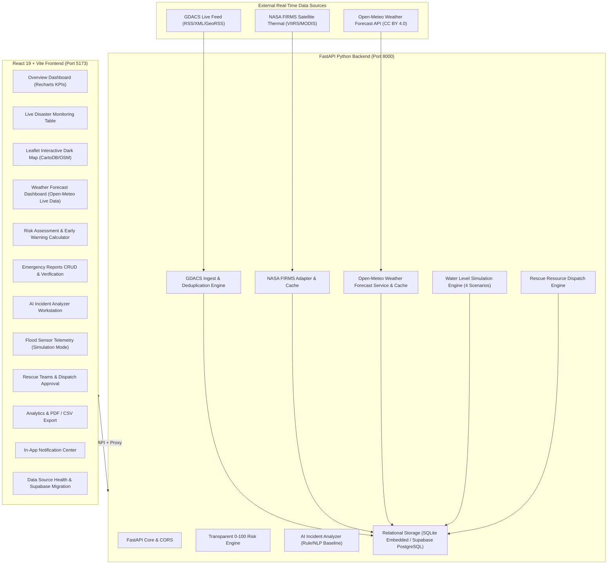

# Disaster Response Analytics Platform
### TechManjari Review-1 Operational Build

A production-minded, full-stack disaster monitoring, risk assessment, and emergency response platform built for **TechManjari Review-1**. 

The system unifies real-time global disaster alerts, satellite fire detection telemetry, empirical hazard risk calculations, citizen emergency intake, AI-assisted triage, software-simulated flood sensor telemetry, and human-in-the-loop rescue resource allocation.

---

> **CRITICAL REVIEW-1 NOTICE — SENSOR TELEMETRY**
>
> **Simulation Mode Active**: Hardware integration (ESP32, physical ultrasonic gauges, LoRa) is intentionally deferred for Review-1 as per project scope. The Sensor Monitoring module runs in clearly labeled **Simulation Mode** (`SIMULATION MODE — NO PHYSICAL SENSOR CONNECTED`). All simulated records are stored with `data_mode = 'simulation'` and feed into the analytics and notification bus. The system includes an authenticated ingest endpoint (`POST /api/sensors/ingest`) ready for physical hardware plug-and-play in future reviews without code refactoring.

---

## 1. System Architecture



---

## 2. Implemented Modules Overview

| Module | Features & Implementation Details | Review-1 Status |
| :--- | :--- | :--- |
| **Module 1: Main Dashboard** | Real-time counts (active, verified, unverified reports, available rescue units), live category and risk distribution charts, feed connection badges, zero fabricated counts. | **Complete & Verified** |
| **Module 2: Real Disaster & Weather Data** | Real GDACS RSS feed parser parsing live global events (300+ events parsed and mapped), NASA FIRMS satellite fire adapter with documented MAP_KEY setup, and live Open-Meteo Weather Forecast integration (temperature, humidity, wind, precipitation, 7-day daily forecast, 24-hr hourly forecast, location presets, CC BY 4.0 attribution). | **Complete & Verified** |
| **Module 3: Interactive GIS Map** | React-Leaflet dark-matter map, color-coded severity markers (Red/Orange/Green), citizen reports, simulated flood stations, rescue bases, layer toggles, and detail drawer. | **Complete & Verified** |
| **Module 4: Risk Assessment** | Transparent 0–100 empirical scoring engine (Flood, Wildfire, Cyclone, Earthquake) with documented formulas. Strict **"Insufficient Data"** handling when metrics are missing. | **Complete & Verified** |
| **Module 5: Emergency Reports** | Full CRUD, status transitions (`Submitted` &rarr; `Under Review` &rarr; `Verified` &rarr; `In Progress` &rarr; `Resolved`), dispatcher verification actions, and search/filtering. | **Complete & Verified** |
| **Module 6: AI Incident Analyzer** | Transparent offline NLP classifier (Flood, Fire, Cyclone, Earthquake, Medical, Landslide), priority suggestions, entity extraction, duplicate report detection, and 1-click filing. | **Complete & Verified** |
| **Module 7: Sensor Monitoring** | Persistent simulation mode banner, 3 river basin stations, live gauges, scenario controls (Flash Flood Surge, Monsoonal Rise, Steady Normal, Storm Recession), threshold alerts. | **Complete (Simulation Mode)** |
| **Module 8: Rescue Teams & Ops** | Fleet management (watercraft boats, ambulances, fire squads, search & rescue), AI resource matching suggestions, human-in-the-loop dispatch authorization, release workflow. | **Complete & Verified** |
| **Module 9: Analytics & Exports** | Database-backed Recharts graphs, real-time CSV export (`/api/analytics/export/csv`), dynamic executive PDF generation using `jspdf` and `jspdf-autotable`. | **Complete & Verified** |
| **Module 10: In-App Notifications** | Real-time notification center, unread badges, deduplication, threshold crossing alerts, and direct incident routing. | **Complete & Verified** |
| **Module 11: Settings & Data Sources** | Live connection monitor for all external feeds, on-demand manual synchronization triggers, and Supabase PostgreSQL migration guide. | **Complete & Verified** |

---

## 3. Local Development Quickstart (Windows 11)

### Prerequisites
- **Node.js** (v18+ or v24+ installed)
- **Python** (3.11+ installed)
- PowerShell or Windows Command Prompt

### Step 1: Start Backend Service
Open a PowerShell terminal in the project root:
```powershell
cd backend

# Activate preconfigured virtual environment
.\venv\Scripts\Activate.ps1

# Run the FastAPI server
python -m uvicorn app.main:app --host 127.0.0.1 --port 8000 --reload
```
The backend API will start on: `http://127.0.0.1:8000`
- Interactive Swagger Documentation: `http://127.0.0.1:8000/docs`
- Health Endpoint: `http://127.0.0.1:8000/health`

### Step 2: Start Frontend Application
Open a second PowerShell terminal in the project root:
```powershell
cd frontend

# Start the Vite development server
npm run dev
```
The frontend application will be live at: `http://localhost:5173/`

---

## 4. Supabase PostgreSQL Migration (Optional / Production)

The application includes an embedded SQLite persistence engine so it runs immediately out-of-the-box without requiring external cloud accounts. 

To link your **Supabase PostgreSQL** cloud database:
1. Create a free project at [supabase.com](https://supabase.com).
2. Open the **SQL Editor** in your Supabase dashboard.
3. Open [`backend/schema.sql`](file:///c:/Users/Dhruv%20Joshi/Desktop/techmanjari/backend/schema.sql) and paste the entire script into the Supabase SQL editor, then click **Run**. This creates:
   - All 14 normalized tables (`profiles`, `incidents`, `emergency_reports`, `risk_assessments`, `sensor_devices`, `sensor_data`, `rescue_teams`, `resource_assignments`, `notifications`, `audit_logs`).
   - Indexes and Row Level Security (RLS) policies.
4. Copy your project URL and service role key into `backend/.env`:
   ```env
   SUPABASE_URL=https://your-project.supabase.co
   SUPABASE_SERVICE_ROLE_KEY=your-service-role-key
   ```
5. Restart the backend service.

---

## 5. External API Configuration

- **GDACS (Global Disaster Alerts)**: Fully active. Uses public RSS/XML GeoRSS feed. No API key required.
- **NASA FIRMS (Satellite Fire Hotspots)**:
  - Register for a free MAP_KEY at [https://firms.modaps.eosdis.nasa.gov/api/map_key/](https://firms.modaps.eosdis.nasa.gov/api/map_key/).
  - Set `NASA_FIRMS_API_KEY=your_key` in `backend/.env`.
  - When the key is unset, the UI and API transparently display `CONFIG_REQUIRED` without fabricating fake fire data.
- **Open-Meteo Weather Forecast API**:
  - Official portal: [https://open-meteo.com/](https://open-meteo.com/).
  - Public forecast endpoint: `https://api.open-meteo.com/v1/forecast`
  - Free & open-source weather API under the **Creative Commons Attribution 4.0 International (CC BY 4.0)** license.
  - No API keys or credentials required.
  - Provides live surface conditions (temperature, humidity, wind speed, precipitation, pressure), 24-hour hourly outlook, and 7-day daily forecasts.
  - Includes transparent in-memory TTL caching (15 min) and coordinate validation.
- **IMD (India Meteorological Department)**:
  - Deprecated / Retired from active polling due to restricted credential access. Kept as a retired status stub in datasource tables.

### Weather API Endpoints:
- `GET /api/weather?latitude=19.0760&longitude=72.8777` — Fetch current, 24-hr hourly, and 7-day daily weather forecast with CC BY 4.0 attribution
- `GET /api/weather/locations` — Retrieve configured default coordinates and preset disaster response command centers
- `POST /api/weather/configured-location` — Update the platform-wide default weather location coordinates

---

## 6. Running Test Suite

Execute the automated backend test suite covering health checks, Open-Meteo weather integrations, CRUD operations, AI categorization, empirical risk scoring, sensor simulation triggers, and dispatch workflows:

```powershell
cd backend
.\venv\Scripts\Activate.ps1
python -m pytest tests/ -v
```

All 24 test cases pass:
- `test_health_endpoint` &rarr; Verified (includes Open-Meteo service acknowledgment)
- `test_dashboard_summary` &rarr; Verified
- `test_create_and_fetch_report` &rarr; Verified
- `test_ai_incident_analyzer` &rarr; Verified
- `test_risk_calculation_sufficient_and_insufficient` &rarr; Verified
- `test_sensor_simulation_and_threshold_detection` &rarr; Verified
- `test_rescue_team_assignment_workflow` &rarr; Verified
- `test_weather_*` (17 unit & mock integration tests) &rarr; Verified:
  - Coordinate validation bounds (`[-90, 90]`, `[-180, 180]`)
  - WMO weather code descriptions & icons
  - Attribution dictionary integrity (CC BY 4.0)
  - Configured location fetch & update persistence
  - Preset command locations (Mumbai, Delhi, Chennai, Kolkata, Bengaluru, Guwahati, Hyderabad)
  - HTTPX timeout, HTTP error, and structured response handling
  - Open-Meteo data source synchronization and legacy IMD deprecation status

---

## 7. TechManjari Review-1 Demonstration Sequence

When presenting this project for Review-1, follow this live demonstration path:

1. **Dashboard Overview (`/`)**:
   - Point out real incident totals (derived from live GDACS sync).
   - Show the data source status cards and live category distribution chart.
2. **GIS Disaster Map (`/map`)**:
   - Show live GDACS disaster events color-coded by alert level (Red for Critical, Orange for High).
   - Toggle layers: show simulated flood sensor stations, citizen reports, and emergency rescue bases.
   - Click any incident marker to open the detailed inspection drawer.
3. **Emergency Report Intake & Verification (`/reports`)**:
   - Click **Submit Emergency Report**.
   - Type a field distress message (e.g., "Heavy waterlogging near residential complex").
   - Click **AI Auto-Classify** &rarr; watch the AI automatically categorize the disaster and assign priority.
   - Submit the report &rarr; show it appears as `Unverified`.
   - Click **Verify** as an authorized dispatcher &rarr; status updates with an audit trail.
4. **AI Incident Analyzer (`/ai-analyzer`)**:
   - Select the preset: *Flood & Stranded Victims*.
   - Click **Analyze Emergency Text**.
   - Show the transparent confidence band, explanation rationale, extracted location ("Kurla West, Mumbai"), and duplicate detection against the database.
   - Click **1-Click File As Verified Report**.
5. **Sensor Monitoring in Simulation Mode (`/sensors`)**:
   - Emphasize the persistent banner: `SIMULATION MODE — NO PHYSICAL SENSOR CONNECTED`.
   - Select station: *Brahmaputra River - Guwahati Basin*.
   - Select the scenario **Flash Flood Surge** and click **Generate Step Tick**.
   - Observe the live water level rise past 4.2m, crossing into **Warning** and **Critical** thresholds.
   - Show the in-app notification bell immediately trigger a `Water Level CRITICAL` alert!
6. **Rescue Teams & Dispatch (`/teams`)**:
   - View available specialized units (Flood Boat Team, Ambulance, Search & Rescue).
   - Click **Deploy Unit** &rarr; select the verified report.
   - Authorize dispatch with human dispatcher approval &rarr; team status changes to `Assigned`.
   - Click **Release Team** &rarr; mission marked completed and unit returned to `Available`.
7. **Analytics & PDF/CSV Export (`/analytics`)**:
   - Inspect empirical category, priority, and sensor trends.
   - Click **Export CSV** &rarr; downloads data spreadsheet with simulation disclaimers.
   - Click **Download PDF Report** &rarr; generates a client-side formatted briefing report.
8. **Live Weather Forecast (`/weather`)**:
   - Inspect live surface telemetry: temperature, humidity, wind speed, precipitation, pressure with units.
   - Switch location presets (Mumbai, Delhi, Chennai, Kolkata, Guwahati, etc.) or input custom coordinates.
   - Review the 7-day daily forecast and 24-hour hourly trajectory.
   - Note the real-time cache indicator and Creative Commons Attribution 4.0 link.
9. **Data Sources & Settings (`/datasources`)**:
   - Review live GDACS connectivity and Open-Meteo weather sync status.
   - Show the registration guide for NASA FIRMS keys.
   - Explain the Supabase PostgreSQL migration script (`backend/schema.sql`).
# techmanjari

